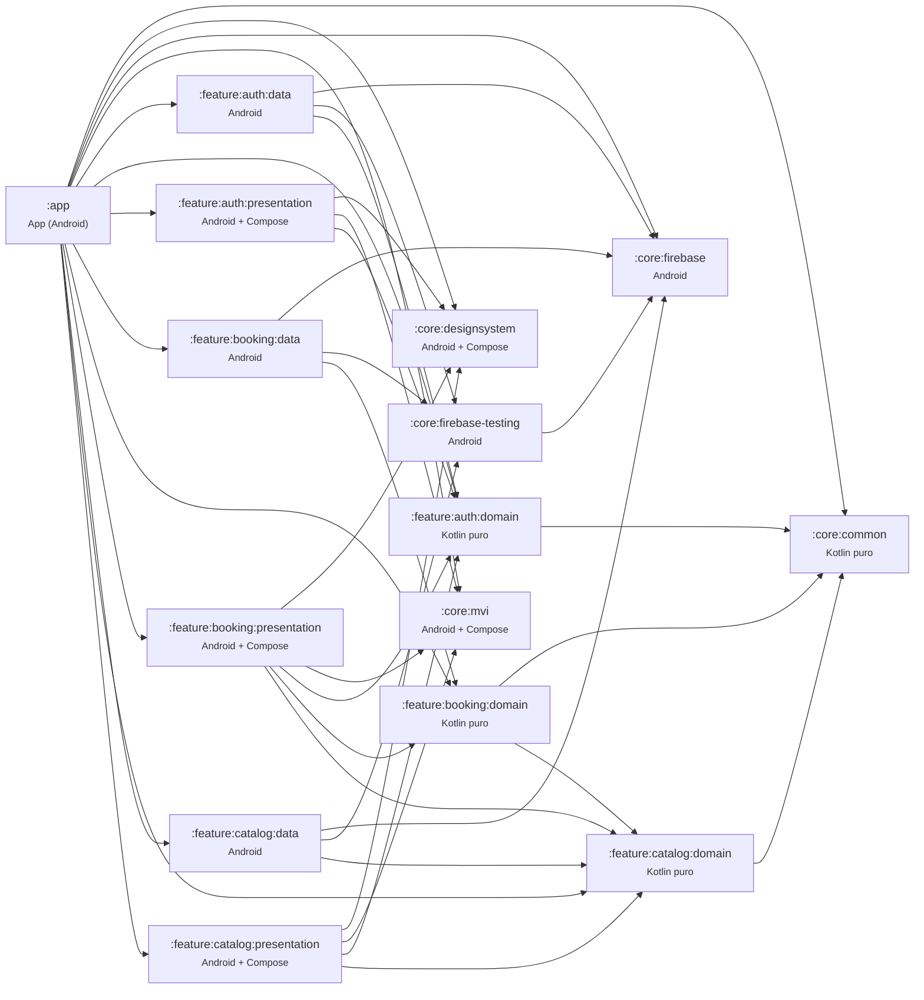
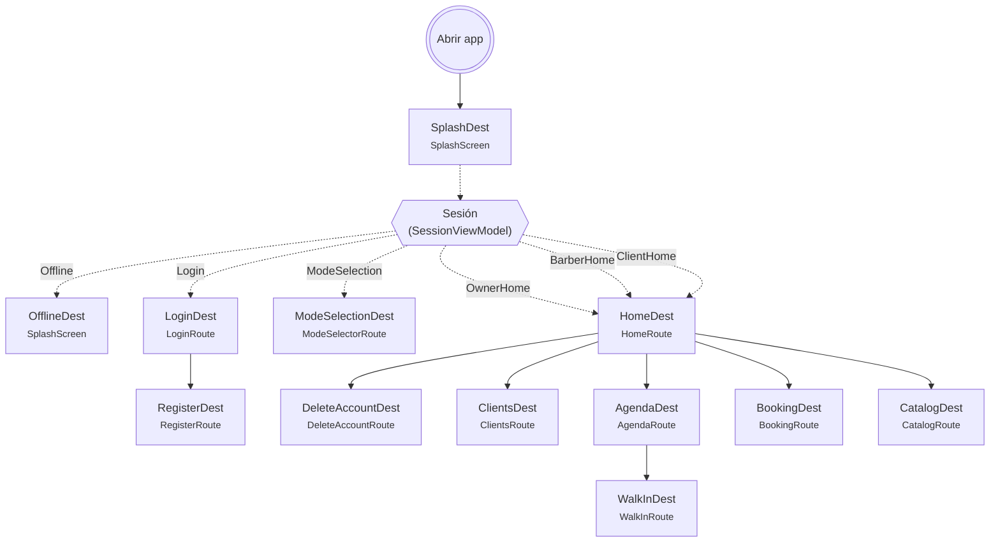

# Mapa de la app

> **Generado por `scripts/app_map.py`. No editar a mano.** El CI falla si no coincide con el código:
> después de cambiar módulos, navegación, ViewModels o reglas, ejecuta `python3 scripts/app_map.py`.
> Versión para IA/herramientas: [`app-map.json`](app-map.json).

## Resumen

| Módulos | Pantallas | Casos de uso | Repositorios | Rutas en Firestore | Tests Kotlin | Tests de reglas |
|---|---|---|---|---|---|---|
| 15 | 12 | 49 | 4 | 10 | 348 | 147 |

## 1. Módulos y dependencias

La flecha va de quien usa a quien es usado. `domain` es Kotlin puro: no conoce Android ni Firebase.

| Módulo | Capa | Archivos Kotlin | Tests | Depende de |
|---|---|---|---|---|
| [`:app`](../app) | App (Android) | 7 | 3 | `:core:common`, `:core:designsystem`, `:core:firebase`, `:core:mvi`, `:feature:auth:data`, `:feature:auth:domain`, `:feature:auth:presentation`, `:feature:booking:data`, `:feature:booking:domain`, `:feature:booking:presentation`, `:feature:catalog:data`, `:feature:catalog:domain`, `:feature:catalog:presentation` |
| [`:core:common`](../core/common) | Kotlin puro | 2 | 2 | — |
| [`:core:mvi`](../core/mvi) | Android + Compose | 2 | 4 | — |
| [`:core:firebase`](../core/firebase) | Android | 3 | 2 | — |
| [`:core:firebase-testing`](../core/firebase-testing) | Android | 1 | 0 | `:core:firebase` |
| [`:core:designsystem`](../core/designsystem) | Android + Compose | 5 | 0 | — |
| [`:feature:auth:domain`](../feature/auth/domain) | Kotlin puro | 6 | 41 | `:core:common` |
| [`:feature:auth:data`](../feature/auth/data) | Android | 6 | 21 | `:core:firebase`, `:core:firebase-testing`, `:feature:auth:domain` |
| [`:feature:auth:presentation`](../feature/auth/presentation) | Android + Compose | 15 | 29 | `:core:designsystem`, `:core:mvi`, `:feature:auth:domain` |
| [`:feature:catalog:domain`](../feature/catalog/domain) | Kotlin puro | 6 | 44 | `:core:common` |
| [`:feature:catalog:data`](../feature/catalog/data) | Android | 8 | 16 | `:core:firebase`, `:core:firebase-testing`, `:feature:catalog:domain` |
| [`:feature:catalog:presentation`](../feature/catalog/presentation) | Android + Compose | 6 | 25 | `:core:designsystem`, `:core:mvi`, `:feature:auth:domain`, `:feature:catalog:domain` |
| [`:feature:booking:domain`](../feature/booking/domain) | Kotlin puro | 14 | 81 | `:core:common`, `:feature:catalog:domain` |
| [`:feature:booking:data`](../feature/booking/data) | Android | 11 | 34 | `:core:firebase`, `:core:firebase-testing`, `:feature:booking:domain` |
| [`:feature:booking:presentation`](../feature/booking/presentation) | Android + Compose | 14 | 46 | `:core:designsystem`, `:core:mvi`, `:feature:auth:domain`, `:feature:booking:domain`, `:feature:catalog:domain` |

## 2. Navegación

Las flechas punteadas las decide **la sesión** (`SessionViewModel`): login, registro, elegir modo y
cerrar sesión solo cambian la sesión y la app navega sola. Las sólidas son botones dentro de una pantalla.

## 3. Pantallas

| Ruta | Pantalla | ViewModel | Intents (lo que el usuario puede hacer) | Casos de uso |
|---|---|---|---|---|
| `SplashDest` | [`SplashScreen`](../feature/auth/presentation/src/main/kotlin/com/barberia/feature/auth/presentation/session/SplashScreen.kt) | [`SessionViewModel`](../feature/auth/presentation/src/main/kotlin/com/barberia/feature/auth/presentation/session/SessionViewModel.kt) | Retry, SignOut | ObserveSessionDestinationUseCase, RetrySessionUseCase, SignOutUseCase |
| `OfflineDest` | [`SplashScreen`](../feature/auth/presentation/src/main/kotlin/com/barberia/feature/auth/presentation/session/SplashScreen.kt) | [`SessionViewModel`](../feature/auth/presentation/src/main/kotlin/com/barberia/feature/auth/presentation/session/SessionViewModel.kt) | Retry, SignOut | ObserveSessionDestinationUseCase, RetrySessionUseCase, SignOutUseCase |
| `LoginDest` | [`LoginRoute`](../feature/auth/presentation/src/main/kotlin/com/barberia/feature/auth/presentation/login/LoginScreen.kt) | [`LoginViewModel`](../feature/auth/presentation/src/main/kotlin/com/barberia/feature/auth/presentation/login/LoginViewModel.kt) | DismissFailure, EmailChanged, ForgotPassword, GoToRegister, PasswordChanged, Submit | SendPasswordResetUseCase, SignInUseCase |
| `RegisterDest` | [`RegisterRoute`](../feature/auth/presentation/src/main/kotlin/com/barberia/feature/auth/presentation/register/RegisterScreen.kt) | [`RegisterViewModel`](../feature/auth/presentation/src/main/kotlin/com/barberia/feature/auth/presentation/register/RegisterViewModel.kt) | Back, BusinessNameChanged, EmailChanged, NameChanged, PasswordChanged, PhoneChanged, Submit, TypeChanged | RegisterClientUseCase, RegisterOwnerUseCase |
| `ModeSelectionDest` | [`ModeSelectorRoute`](../feature/auth/presentation/src/main/kotlin/com/barberia/feature/auth/presentation/mode/ModeSelector.kt) | [`ModeSelectorViewModel`](../feature/auth/presentation/src/main/kotlin/com/barberia/feature/auth/presentation/mode/ModeSelector.kt) | Select | ObserveCurrentUserUseCase, SelectModeUseCase |
| `HomeDest` | [`HomeRoute`](../app/src/main/kotlin/com/barberia/app/home/HomeScreen.kt) | [`HomeViewModel`](../app/src/main/kotlin/com/barberia/app/home/HomeViewModel.kt) + `ClientHomeRoute` (ClientHomeViewModel), `ShareCodeCard` (ShareCodeViewModel), `StaffAccessCard` (StaffAccessViewModel), `VerifyEmailCard` (VerifyEmailViewModel), `LoyaltyCard` (LoyaltyViewModel), `RedeemInviteCard` (RedeemInviteViewModel) | Cancel, Check, CodeChanged, DismissFailure, Join, Leave, Redeem, Resend, SignOut | CancelAppointmentUseCase, CancelReminderUseCase, CheckEmailVerifiedUseCase, CheckStaffAccessUseCase, EnsureShareCodeUseCase, JoinBarbershopUseCase, LeaveBarbershopUseCase, LeaveStaffUseCase, ObserveCurrentUserUseCase, ObserveJoinedBarbershopUseCase, ObserveMyAppointmentsUseCase, ObserveMyLoyaltyUseCase, RedeemBarberInviteUseCase, ResendVerificationEmailUseCase, RetrySessionUseCase, SignOutUseCase, SyncRemindersUseCase |
| `DeleteAccountDest` | [`DeleteAccountRoute`](../feature/auth/presentation/src/main/kotlin/com/barberia/feature/auth/presentation/account/DeleteAccount.kt) | [`DeleteAccountViewModel`](../feature/auth/presentation/src/main/kotlin/com/barberia/feature/auth/presentation/account/DeleteAccount.kt) | Confirm, PasswordChanged, UnderstoodToggled | DeleteAccountUseCase, ObserveCurrentUserUseCase |
| `ClientsDest` | [`ClientsRoute`](../feature/booking/presentation/src/main/kotlin/com/barberia/feature/booking/presentation/clients/Clients.kt) | [`ClientsViewModel`](../feature/booking/presentation/src/main/kotlin/com/barberia/feature/booking/presentation/clients/Clients.kt) | DismissFailure, Forgive, Redeem | ForgivePenaltyUseCase, ObserveClientsUseCase, ObserveCurrentUserUseCase, RedeemRewardUseCase |
| `AgendaDest` | [`AgendaRoute`](../feature/booking/presentation/src/main/kotlin/com/barberia/feature/booking/presentation/agenda/AgendaScreen.kt) | [`AgendaViewModel`](../feature/booking/presentation/src/main/kotlin/com/barberia/feature/booking/presentation/agenda/AgendaViewModel.kt) | Cancel, Complete, DismissFailure, FilterBarber, NextDay, NoShow, PreviousDay, Today, Undo | CancelByStaffUseCase, GetBarbershopUseCase, MarkCompletedUseCase, MarkNoShowUseCase, ObserveAgendaUseCase, ObserveCatalogUseCase, ObserveCurrentUserUseCase, UndoMarkUseCase |
| `WalkInDest` | [`WalkInRoute`](../feature/booking/presentation/src/main/kotlin/com/barberia/feature/booking/presentation/walkin/WalkIn.kt) | [`WalkInViewModel`](../feature/booking/presentation/src/main/kotlin/com/barberia/feature/booking/presentation/walkin/WalkIn.kt) | Confirm, NameChanged, PhoneChanged, SelectBarber, SelectDate, SelectService, SelectSlot | BookWalkInUseCase, GetAvailableSlotsUseCase, GetBarbershopUseCase, ObserveCatalogUseCase, ObserveCurrentUserUseCase |
| `BookingDest` | [`BookingRoute`](../feature/booking/presentation/src/main/kotlin/com/barberia/feature/booking/presentation/book/BookingScreen.kt) | [`BookingViewModel`](../feature/booking/presentation/src/main/kotlin/com/barberia/feature/booking/presentation/book/BookingViewModel.kt) | Confirm, DismissFailure, SelectBarber, SelectDate, SelectService, SelectSlot | BookAppointmentUseCase, GetAvailableSlotsUseCase, ObserveCatalogUseCase, ObserveCurrentUserUseCase, ObserveJoinedBarbershopUseCase |
| `CatalogDest` | [`CatalogRoute`](../feature/catalog/presentation/src/main/kotlin/com/barberia/feature/catalog/presentation/CatalogScreen.kt) | [`CatalogViewModel`](../feature/catalog/presentation/src/main/kotlin/com/barberia/feature/catalog/presentation/CatalogViewModel.kt) | BarberNameChanged, DayEndChanged, DayStartChanged, DayToggled, DismissDialog, DismissFailure, InviteBarber, OpenEditBarber, OpenEditService, OpenNewBarber, OpenNewService, OpenRevokeAccess, OpenSchedule, OpenTimeOff, RemoveTimeOff, SaveDialog, ServiceDurationChanged, ServiceNameChanged, ServicePriceChanged, SetBarberActive, SetServiceActive, TabSelected, TimeOffDateChanged, TimeOffEndChanged, TimeOffStartChanged, TimeOffWholeDayToggled | AddBarberUseCase, AddServiceUseCase, AddTimeOffUseCase, CreateBarberInviteUseCase, ObserveCatalogUseCase, ObserveCurrentUserUseCase, RemoveTimeOffUseCase, RenameBarberUseCase, RevokeBarberAccessUseCase, SetBarberActiveUseCase, SetBarberScheduleUseCase, SetServiceActiveUseCase, UpdateServiceUseCase |

## 4. Recorridos de prueba

Camino más corto desde que se abre la app hasta cada pantalla. Sirve para probar a mano o
para escribir una prueba de interfaz.

- **SplashDest**: es la pantalla inicial.
- **OfflineDest**: abrir app → `OfflineDest` (la sesión resuelve **Offline**)
- **LoginDest**: abrir app → `LoginDest` (la sesión resuelve **Login**)
- **RegisterDest**: abrir app → `LoginDest` (la sesión resuelve **Login**) → `RegisterDest` (tocar el botón que navega)
- **ModeSelectionDest**: abrir app → `ModeSelectionDest` (la sesión resuelve **ModeSelection**)
- **HomeDest**: abrir app → `HomeDest` (la sesión resuelve **OwnerHome**)
- **DeleteAccountDest**: abrir app → `HomeDest` (la sesión resuelve **OwnerHome**) → `DeleteAccountDest` (tocar el botón que navega)
- **ClientsDest**: abrir app → `HomeDest` (la sesión resuelve **OwnerHome**) → `ClientsDest` (tocar el botón que navega)
- **AgendaDest**: abrir app → `HomeDest` (la sesión resuelve **OwnerHome**) → `AgendaDest` (tocar el botón que navega)
- **WalkInDest**: abrir app → `HomeDest` (la sesión resuelve **OwnerHome**) → `AgendaDest` (tocar el botón que navega) → `WalkInDest` (tocar el botón que navega)
- **BookingDest**: abrir app → `HomeDest` (la sesión resuelve **OwnerHome**) → `BookingDest` (tocar el botón que navega)
- **CatalogDest**: abrir app → `HomeDest` (la sesión resuelve **OwnerHome**) → `CatalogDest` (tocar el botón que navega)

## 5. Casos de uso → repositorios

⚠️ **1 caso de uso sin pantalla** (lógica lista que nadie usa todavía): `EraseUserDataUseCase`

| Caso de uso | Usa | Lo usan las pantallas | Archivo |
|---|---|---|---|
| `AddBarberUseCase` | CatalogEditor, CatalogRepository | `CatalogDest` | [CatalogUseCases.kt](../feature/catalog/domain/src/main/kotlin/com/barberia/feature/catalog/domain/usecase/CatalogUseCases.kt) |
| `AddServiceUseCase` | CatalogEditor, CatalogRepository | `CatalogDest` | [CatalogUseCases.kt](../feature/catalog/domain/src/main/kotlin/com/barberia/feature/catalog/domain/usecase/CatalogUseCases.kt) |
| `AddTimeOffUseCase` | CatalogEditor, CatalogRepository | `CatalogDest` | [CatalogUseCases.kt](../feature/catalog/domain/src/main/kotlin/com/barberia/feature/catalog/domain/usecase/CatalogUseCases.kt) |
| `BookAppointmentUseCase` | BookingRepository, CatalogRepository | `BookingDest` | [BookingUseCases.kt](../feature/booking/domain/src/main/kotlin/com/barberia/feature/booking/domain/usecase/BookingUseCases.kt) |
| `BookWalkInUseCase` | BookingRepository, CatalogRepository | `WalkInDest` | [BookingUseCases.kt](../feature/booking/domain/src/main/kotlin/com/barberia/feature/booking/domain/usecase/BookingUseCases.kt) |
| `CancelAppointmentUseCase` | BookingRepository | `HomeDest` | [BookingUseCases.kt](../feature/booking/domain/src/main/kotlin/com/barberia/feature/booking/domain/usecase/BookingUseCases.kt) |
| `CancelByStaffUseCase` | BookingRepository | `AgendaDest` | [AgendaUseCases.kt](../feature/booking/domain/src/main/kotlin/com/barberia/feature/booking/domain/usecase/AgendaUseCases.kt) |
| `CancelReminderUseCase` | — | `HomeDest` | [ReminderUseCases.kt](../feature/booking/domain/src/main/kotlin/com/barberia/feature/booking/domain/usecase/ReminderUseCases.kt) |
| `CheckEmailVerifiedUseCase` | AuthRepository | `HomeDest` | [AuthUseCases.kt](../feature/auth/domain/src/main/kotlin/com/barberia/feature/auth/domain/usecase/AuthUseCases.kt) |
| `CheckStaffAccessUseCase` | AuthRepository, SessionRepository | `HomeDest` | [AuthUseCases.kt](../feature/auth/domain/src/main/kotlin/com/barberia/feature/auth/domain/usecase/AuthUseCases.kt) |
| `CreateBarberInviteUseCase` | CatalogRepository, InviteRepository | `CatalogDest` | [InviteUseCases.kt](../feature/catalog/domain/src/main/kotlin/com/barberia/feature/catalog/domain/usecase/InviteUseCases.kt) |
| `DeleteAccountUseCase` | AuthRepository, SessionRepository | `DeleteAccountDest` | [AuthUseCases.kt](../feature/auth/domain/src/main/kotlin/com/barberia/feature/auth/domain/usecase/AuthUseCases.kt) |
| `EnsureShareCodeUseCase` | BookingRepository | `HomeDest` | [BookingUseCases.kt](../feature/booking/domain/src/main/kotlin/com/barberia/feature/booking/domain/usecase/BookingUseCases.kt) |
| `EraseUserDataUseCase` | AccountDataRepository, BookingRepository | ⚠️ ninguna | [AccountDataUseCases.kt](../feature/booking/domain/src/main/kotlin/com/barberia/feature/booking/domain/usecase/AccountDataUseCases.kt) |
| `ForgivePenaltyUseCase` | BookingRepository | `ClientsDest` | [LoyaltyUseCases.kt](../feature/booking/domain/src/main/kotlin/com/barberia/feature/booking/domain/usecase/LoyaltyUseCases.kt) |
| `GetAvailableSlotsUseCase` | BookingRepository, CatalogRepository | `BookingDest`, `WalkInDest` | [BookingUseCases.kt](../feature/booking/domain/src/main/kotlin/com/barberia/feature/booking/domain/usecase/BookingUseCases.kt) |
| `GetBarbershopUseCase` | BookingRepository | `AgendaDest`, `WalkInDest` | [AgendaUseCases.kt](../feature/booking/domain/src/main/kotlin/com/barberia/feature/booking/domain/usecase/AgendaUseCases.kt) |
| `JoinBarbershopUseCase` | BookingRepository | `HomeDest` | [BookingUseCases.kt](../feature/booking/domain/src/main/kotlin/com/barberia/feature/booking/domain/usecase/BookingUseCases.kt) |
| `LeaveBarbershopUseCase` | BookingRepository | `HomeDest` | [BookingUseCases.kt](../feature/booking/domain/src/main/kotlin/com/barberia/feature/booking/domain/usecase/BookingUseCases.kt) |
| `LeaveStaffUseCase` | AuthRepository, SessionRepository | `HomeDest` | [AuthUseCases.kt](../feature/auth/domain/src/main/kotlin/com/barberia/feature/auth/domain/usecase/AuthUseCases.kt) |
| `MarkCompletedUseCase` | BookingRepository | `AgendaDest` | [AgendaUseCases.kt](../feature/booking/domain/src/main/kotlin/com/barberia/feature/booking/domain/usecase/AgendaUseCases.kt) |
| `MarkNoShowUseCase` | BookingRepository | `AgendaDest` | [AgendaUseCases.kt](../feature/booking/domain/src/main/kotlin/com/barberia/feature/booking/domain/usecase/AgendaUseCases.kt) |
| `ObserveAgendaUseCase` | BookingRepository | `AgendaDest` | [AgendaUseCases.kt](../feature/booking/domain/src/main/kotlin/com/barberia/feature/booking/domain/usecase/AgendaUseCases.kt) |
| `ObserveCatalogUseCase` | CatalogRepository | `AgendaDest`, `BookingDest`, `CatalogDest`, `WalkInDest` | [CatalogUseCases.kt](../feature/catalog/domain/src/main/kotlin/com/barberia/feature/catalog/domain/usecase/CatalogUseCases.kt) |
| `ObserveClientsUseCase` | BookingRepository | `ClientsDest` | [LoyaltyUseCases.kt](../feature/booking/domain/src/main/kotlin/com/barberia/feature/booking/domain/usecase/LoyaltyUseCases.kt) |
| `ObserveCurrentUserUseCase` | SessionRepository | `AgendaDest`, `BookingDest`, `CatalogDest`, `ClientsDest`, `DeleteAccountDest`, `HomeDest`, `ModeSelectionDest`, `WalkInDest` | [AuthUseCases.kt](../feature/auth/domain/src/main/kotlin/com/barberia/feature/auth/domain/usecase/AuthUseCases.kt) |
| `ObserveJoinedBarbershopUseCase` | BookingRepository | `BookingDest`, `HomeDest` | [BookingUseCases.kt](../feature/booking/domain/src/main/kotlin/com/barberia/feature/booking/domain/usecase/BookingUseCases.kt) |
| `ObserveMyAppointmentsUseCase` | BookingRepository | `HomeDest` | [BookingUseCases.kt](../feature/booking/domain/src/main/kotlin/com/barberia/feature/booking/domain/usecase/BookingUseCases.kt) |
| `ObserveMyLoyaltyUseCase` | BookingRepository | `HomeDest` | [LoyaltyUseCases.kt](../feature/booking/domain/src/main/kotlin/com/barberia/feature/booking/domain/usecase/LoyaltyUseCases.kt) |
| `ObserveSessionDestinationUseCase` | SessionRepository | `OfflineDest`, `SplashDest` | [AuthUseCases.kt](../feature/auth/domain/src/main/kotlin/com/barberia/feature/auth/domain/usecase/AuthUseCases.kt) |
| `RedeemBarberInviteUseCase` | CatalogRepository, InviteRepository | `HomeDest` | [InviteUseCases.kt](../feature/catalog/domain/src/main/kotlin/com/barberia/feature/catalog/domain/usecase/InviteUseCases.kt) |
| `RedeemRewardUseCase` | BookingRepository | `ClientsDest` | [LoyaltyUseCases.kt](../feature/booking/domain/src/main/kotlin/com/barberia/feature/booking/domain/usecase/LoyaltyUseCases.kt) |
| `RegisterClientUseCase` | AuthRepository | `RegisterDest` | [AuthUseCases.kt](../feature/auth/domain/src/main/kotlin/com/barberia/feature/auth/domain/usecase/AuthUseCases.kt) |
| `RegisterOwnerUseCase` | AuthRepository | `RegisterDest` | [AuthUseCases.kt](../feature/auth/domain/src/main/kotlin/com/barberia/feature/auth/domain/usecase/AuthUseCases.kt) |
| `RemoveTimeOffUseCase` | CatalogEditor, CatalogRepository | `CatalogDest` | [CatalogUseCases.kt](../feature/catalog/domain/src/main/kotlin/com/barberia/feature/catalog/domain/usecase/CatalogUseCases.kt) |
| `RenameBarberUseCase` | CatalogEditor, CatalogRepository | `CatalogDest` | [CatalogUseCases.kt](../feature/catalog/domain/src/main/kotlin/com/barberia/feature/catalog/domain/usecase/CatalogUseCases.kt) |
| `ResendVerificationEmailUseCase` | AuthRepository | `HomeDest` | [AuthUseCases.kt](../feature/auth/domain/src/main/kotlin/com/barberia/feature/auth/domain/usecase/AuthUseCases.kt) |
| `RetrySessionUseCase` | SessionRepository | `HomeDest`, `OfflineDest`, `SplashDest` | [AuthUseCases.kt](../feature/auth/domain/src/main/kotlin/com/barberia/feature/auth/domain/usecase/AuthUseCases.kt) |
| `RevokeBarberAccessUseCase` | InviteRepository | `CatalogDest` | [InviteUseCases.kt](../feature/catalog/domain/src/main/kotlin/com/barberia/feature/catalog/domain/usecase/InviteUseCases.kt) |
| `SelectModeUseCase` | SessionRepository | `ModeSelectionDest` | [AuthUseCases.kt](../feature/auth/domain/src/main/kotlin/com/barberia/feature/auth/domain/usecase/AuthUseCases.kt) |
| `SendPasswordResetUseCase` | AuthRepository | `LoginDest` | [AuthUseCases.kt](../feature/auth/domain/src/main/kotlin/com/barberia/feature/auth/domain/usecase/AuthUseCases.kt) |
| `SetBarberActiveUseCase` | CatalogEditor, CatalogRepository | `CatalogDest` | [CatalogUseCases.kt](../feature/catalog/domain/src/main/kotlin/com/barberia/feature/catalog/domain/usecase/CatalogUseCases.kt) |
| `SetBarberScheduleUseCase` | CatalogEditor, CatalogRepository | `CatalogDest` | [CatalogUseCases.kt](../feature/catalog/domain/src/main/kotlin/com/barberia/feature/catalog/domain/usecase/CatalogUseCases.kt) |
| `SetServiceActiveUseCase` | CatalogEditor, CatalogRepository | `CatalogDest` | [CatalogUseCases.kt](../feature/catalog/domain/src/main/kotlin/com/barberia/feature/catalog/domain/usecase/CatalogUseCases.kt) |
| `SignInUseCase` | AuthRepository | `LoginDest` | [AuthUseCases.kt](../feature/auth/domain/src/main/kotlin/com/barberia/feature/auth/domain/usecase/AuthUseCases.kt) |
| `SignOutUseCase` | AuthRepository, SessionRepository | `HomeDest`, `OfflineDest`, `SplashDest` | [AuthUseCases.kt](../feature/auth/domain/src/main/kotlin/com/barberia/feature/auth/domain/usecase/AuthUseCases.kt) |
| `SyncRemindersUseCase` | — | `HomeDest` | [ReminderUseCases.kt](../feature/booking/domain/src/main/kotlin/com/barberia/feature/booking/domain/usecase/ReminderUseCases.kt) |
| `UndoMarkUseCase` | BookingRepository | `AgendaDest` | [AgendaUseCases.kt](../feature/booking/domain/src/main/kotlin/com/barberia/feature/booking/domain/usecase/AgendaUseCases.kt) |
| `UpdateServiceUseCase` | CatalogEditor, CatalogRepository | `CatalogDest` | [CatalogUseCases.kt](../feature/catalog/domain/src/main/kotlin/com/barberia/feature/catalog/domain/usecase/CatalogUseCases.kt) |

| Implementación | Implementa | Archivo |
|---|---|---|
| `FirestoreAccountDataRepository` | AccountDataRepository | [FirestoreAccountDataRepository.kt](../feature/booking/data/src/main/kotlin/com/barberia/feature/booking/data/repository/FirestoreAccountDataRepository.kt) |
| `FirestoreBookingRepository` | BookingRepository | [FirestoreBookingRepository.kt](../feature/booking/data/src/main/kotlin/com/barberia/feature/booking/data/repository/FirestoreBookingRepository.kt) |
| `FirestoreCatalogRepository` | CatalogRepository | [FirestoreCatalogRepository.kt](../feature/catalog/data/src/main/kotlin/com/barberia/feature/catalog/data/repository/FirestoreCatalogRepository.kt) |
| `FirestoreInviteRepository` | InviteRepository | [FirestoreInviteRepository.kt](../feature/catalog/data/src/main/kotlin/com/barberia/feature/catalog/data/repository/FirestoreInviteRepository.kt) |

## 6. Datos en Firestore (según las reglas)

✗ = prohibido explícitamente.

| Ruta | Operaciones |
|---|---|
| `/users/{uid}` | read, create, update, delete |
| `/tenants/{tenantId}` | get, list ✗, create, update, delete |
| `/tenants/{tenantId}/catalog/{docId}` | get, list ✗, create, update, delete |
| `/tenants/{tenantId}/appointments/{apptId}` | get, list, create, update, delete |
| `/tenants/{tenantId}/days/{dayId}` | get, list ✗, create, update, delete |
| `/tenants/{tenantId}/revoked/{staffUid}` | get, list, create, update ✗, delete |
| `/shareCodes/{code}` | get, list ✗, create, update ✗, delete |
| `/tenants/{tenantId}/clients/{clientUid}` | get, list, create, update, delete |
| `/staffInvites/{code}` | get, list, create, update, delete |
| `/{path=**}/appointments/{apptId}` | list |

## 7. ¿Dónde le muevo?

| Quiero cambiar… | Ve a… |
|---|---|
| Una regla de negocio (validación, cálculo) | `feature/<x>/domain/.../usecase` o `.../editor`, con su test en `src/test` |
| Lo que se ve en una pantalla | El archivo de la columna *Pantalla* (sección 3) |
| Qué pasa cuando el usuario toca algo | El *ViewModel* de esa pantalla → `handleIntent` |
| Cómo se guarda o lee en Firebase | `feature/<x>/data/.../firebase` (gateway) y su repositorio |
| Quién puede leer/escribir un dato | `firebase/firestore.rules` + `firebase/test/*.test.js` |
| A dónde va el usuario al iniciar sesión | `resolveDestination` en `feature/auth/domain/.../SessionState.kt` |
| Una ruta o botón de navegación | `app/.../navigation/BarberiaNavHost.kt` |
| Colores, botones, campos | `core/designsystem` |
| Configuración de Gradle común | `build-logic/convention` |
| Textos | `src/main/res/values/strings.xml` del módulo de la pantalla |
